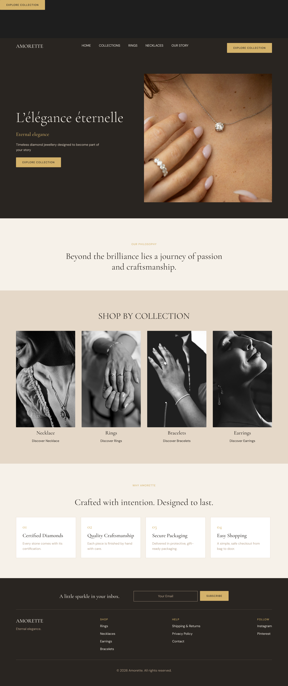

# Amorette: Landing Page Design (Figma)

A desktop landing page design for **Amorette**, a fictional high-end diamond jewellery brand. Created in Figma as part of the UI/UX using Figma task.

**Figma file:** https://www.figma.com/design/gdAunF6NmNkLJC8antxCbe/Amorette-Landing-Page?node-id=0-1&t=cRASkGaLRakSgt5c-1

> Status: work in progress. Header, hero, brand introduction and collections sections are complete. Feature cards ("Why Amorette") and the footer are being added.

## Preview
Add exported screenshots in the `screenshots/` folder:

## Brand

- **Name:** Amorette (romantic, refined, French-inspired)
- **Sells:** Diamond jewellery only (rings, necklaces, earrings, bracelets)
- **Positioning:** High-end luxury
- **Tagline / hero headline:** *L'élégance éternelle* (Eternal elegance)

## Intended users

- Women buying jewellery for themselves
- Couples and engagement shoppers
- Gift buyers
- Young professionals

## Design choices

- **Direction:** Modern luxury. Bold, contemporary and minimal, with large photography and plenty of whitespace.
- **Theme:** A mix of dark and light. The hero is dark Espresso for drama, while the following sections use Ivory and Champagne for a soft, premium feel.
- **Colour palette:** Ivory, Champagne, Taupe, Espresso and White, with a Gold accent used only for buttons and small highlights.
- **Typography:**
  - Headings: Cormorant Garamond (elegant serif)
  - Body and buttons: DM Sans (clean sans-serif), with small uppercase button text
- **Imagery:** Free stock photography chosen to match the brand mood: close-ups of jewellery worn on skin, warm tones, and black-and-white editorial shots in the collections.
- **Layout:** Built with Auto Layout for the header, hero, sections, cards and buttons so spacing stays consistent.

## Page structure

1. Header: logo, navigation (Home, Collections, Rings, Necklaces, Our Story) and "Explore Collection" CTA
2. Hero: headline, short description, CTA button and campaign image
3. Brand introduction: "Our philosophy"
4. Shop by collection: Necklace, Rings, Bracelets, Earrings
5. Why Amorette (feature cards): in progress
6. Footer: in progress

## Design system

**Colour styles:** Ivory, Champagne, Taupe, Espresso, White, Gold

**Text styles:** Body (16/26), Button (13), Heading H1 (72), H2 (44), H3 (28)

**Reusable components:**
- Button (primary CTA)
- Collection Card
- Feature Card

## Tools

- Figma (browser, free plan)
- Fonts: Cormorant Garamond and DM Sans (Google Fonts)
- Images: free stock photos (Unsplash / Pexels)

## Author

Designed by Priya Choudhary

Individual submission for UI/UX using Figma.
